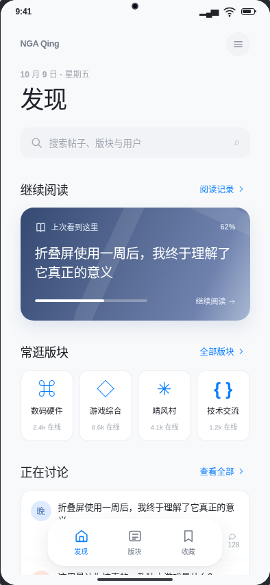
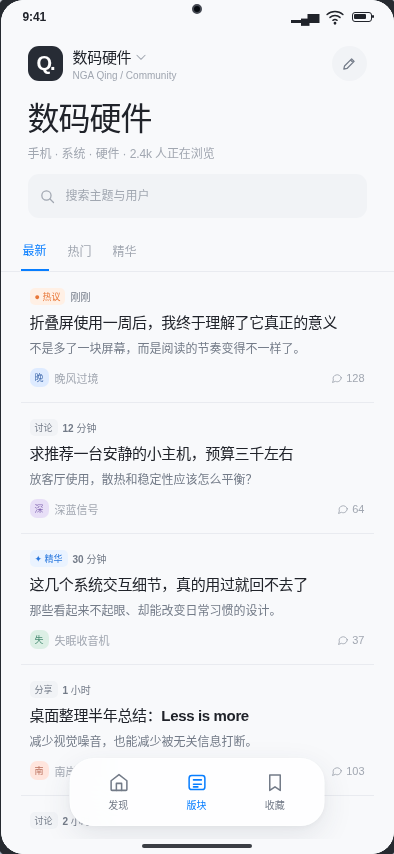
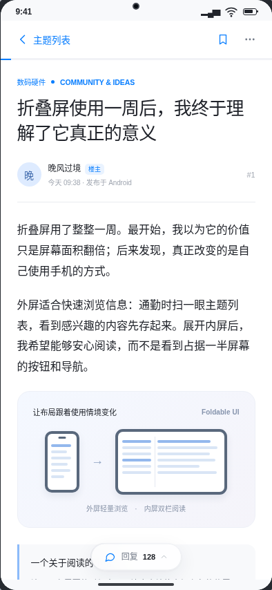
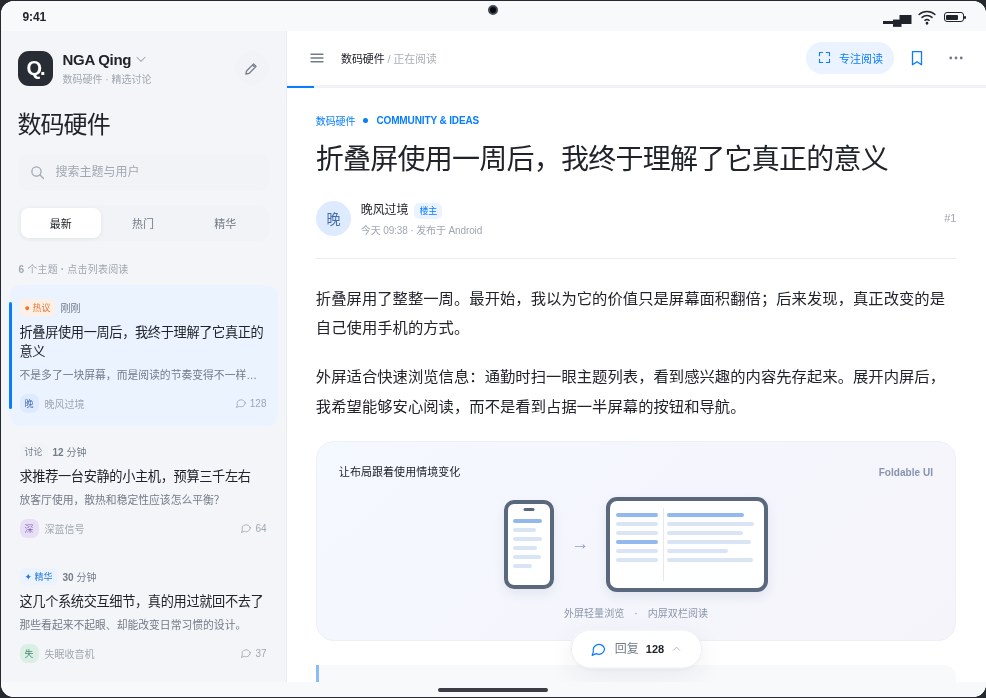

# nga-qing

`nga-qing` 是使用 Kotlin 和 Jetpack Compose 编写的非官方 NGA Android 客户端。当前版本为 **1.2.2（versionCode 7）**，支持 Android 7.0 及以上的 ARM64 设备。

## 界面预览

以下图片由 V8 HTML 设计原型渲染，使用示例内容，**不是实机截图**。搜索入口、导航等细节以 1.2.2 实际界面为准；实现对照见 [V8 设计说明](docs/ui-v8-audit.md)。

| 发现 | 主题列表 | 帖子阅读 |
| :---: | :---: | :---: |
|  |  |  |

内屏横屏双栏阅读：



## 功能

- 发现、版块、收藏、我的四个入口；根据手机、折叠屏和窗口空间调整布局，宽屏支持主题列表与正文双栏阅读。
- 父子版块与合集分类、主题搜索与排序、离线缓存、收藏分组与同步、浏览历史及阅读位置恢复。
- 原生帖子阅读、头像、图片、表情、代码/表格/折叠、楼层操作、翻页和只看楼主。
- 新建主题、回复与引用、自动草稿、图片和附件；回复提醒、私信、关注主题、用户主页及本机多账号切换。
- 阅读字号、行距、签名与专注阅读偏好；支持系统返回、内容区右滑返回、多个 NGA 入口域名及网页登录兜底。

主题、回复和收藏同步依赖 NGA 当前网页/API 行为。写入失败时会保留草稿并显示错误，不会自动重复提交。账号凭证保存在应用私有目录，系统云备份已禁用。

## 安装与构建

已交付的 `nga-qing-1.2.2-v8.apk` 可安装到 Android 7.0 及以上 ARM64 设备；与同包名、同签名的旧版可覆盖安装并保留应用数据。包名为 `com.qingyi5427.ngaqing`。旧包名 `com.ngaclient.app` 属于独立应用，不会自动迁移其登录状态、收藏或历史。

自行构建需要 JDK 21 和 Android SDK 35。在项目目录运行：

```powershell
.\gradlew.bat testDebugUnitTest lintDebug assembleDebug
```

其他平台使用 `./gradlew`。V8 验收与发布包记录见 [交付文档](HANDOFF.md)；布局和测试证据见 [V8 QA](docs/ui-v8-qa/validation-1.2.2.md)。

## 来源与许可

项目代码按 [GPL-2.0](LICENSE) 发布。第三方项目与 NGA 资源的使用边界见 [来源台账](SOURCES.md) 和 [第三方声明](THIRD_PARTY_NOTICES.md)。V8 蓝白启动图标由仓库内脚本生成。分发修改版 APK 时应同时提供对应源代码，保留许可与来源声明，并说明修改内容。
