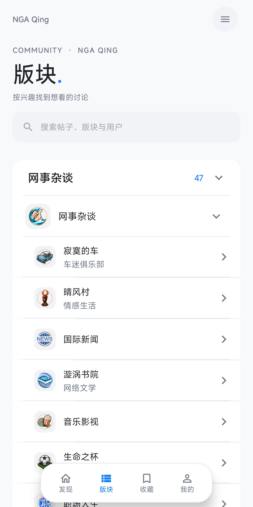
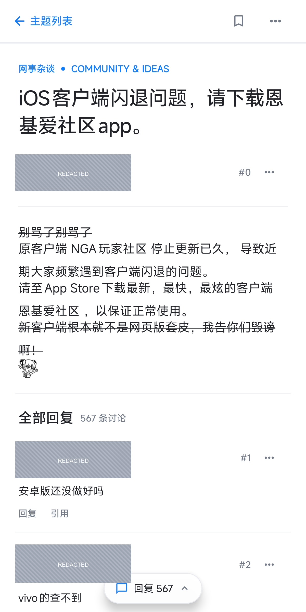
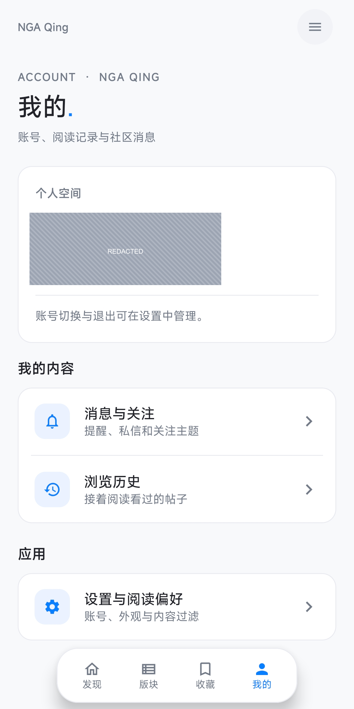

# NGA Qing

使用 Kotlin 和 Jetpack Compose 编写的非官方 NGA Android 客户端。当前版本 **1.2.5（versionCode 10）**，支持 Android 7.0 及以上的 ARM64 设备。

[下载 1.2.5 APK](https://github.com/qing-yi-5427/nga-qing/releases/download/v1.2.5/nga-qing-1.2.5-v8.apk) · [发布页与对应源码](https://github.com/qing-yi-5427/nga-qing/releases/tag/v1.2.5) · [APK 校验记录](docs/releases/1.2.5.md)

## 界面预览

以下为手机上实际运行 **1.2.5** 的截图。用户名、UID 和头像已遮挡，并裁去系统状态栏；原始截图与未打码账号信息不入仓库。

| 版块目录 | 帖子阅读 | 账号与设置 |
| :---: | :---: | :---: |
|  |  |  |

自适应界面实现与历史布局验证见 [V8 设计说明](docs/ui-v8-audit.md)。

## 功能

- 发现、版块、收藏、我的四个入口；根据手机、折叠屏和窗口空间调整布局，宽屏支持主题列表与正文双栏阅读。
- 父子版块与合集分类、主题搜索与排序、离线缓存、收藏分组与同步、浏览历史及阅读位置恢复。
- 原生帖子阅读、头像、图片、表情、代码、表格、折叠内容、楼层操作、翻页与只看楼主。
- 发帖、回复与引用、自动草稿、图片附件；回复提醒、私信、关注主题、用户主页及本机多账号切换。
- 字号、行距、签名与专注阅读偏好；系统返回、内容区右滑返回、多个 NGA 入口域名及网页登录兜底。

### 1.2.5 更新

- 云收藏新增和移除后自动回读服务器，确认成功后再更新界面与本地记录，无需手动重新读取。
- 移除文件夹最后一篇主题时，明确提示该操作将删除收藏夹；二次确认后执行，取消不写入。
- 保留此前 V8 原生自适应界面、阅读位置恢复，以及阅读页内嵌视频卡片和后续正文。

主题、回复和收藏依赖 NGA 当前网页/API。写入失败会显示错误，不自动重复提交；发帖/回复失败保留草稿。账号凭证保存在应用私有目录，系统云备份已禁用。

## 安装与校验

1. 在 [1.2.5 发布页](https://github.com/qing-yi-5427/nga-qing/releases/tag/v1.2.5) 下载 `nga-qing-1.2.5-v8.apk` 和同名 `.sha256` 校验文件。
2. 可在 PowerShell 执行 `Get-FileHash .\nga-qing-1.2.5-v8.apk -Algorithm SHA256`，与校验文件对照，再安装 APK。
3. 与同包名、同签名的旧版可覆盖升级并保留应用数据。安装器提示签名不兼容时，先核对包名与签名，不要直接卸载原应用。

包名为 `com.qingyi5427.ngaqing`。旧包名 `com.ngaclient.app` 属于独立应用，不会自动迁移其登录状态、收藏或历史。本次 APK 沿用既有开发证书，使用 Release/R8 优化；自行构建默认使用本机调试证书，签名通常与发布包不同。

源码标签、文件摘要、签名指纹与核验范围见 [1.2.5 发布核验](docs/releases/1.2.5.md)。发布页保留对应源码下载，旧版本仍可在 Releases 中查找。

## 自行构建

需要 JDK 21 和 Android SDK 35。配置本机 Android SDK 后，在项目目录运行：

```powershell
.\gradlew.bat testDebugUnitTest lintDebug assembleDebug
```

构建经过 R8 优化的 Release APK：

```powershell
.\gradlew.bat assembleRelease
```

其他平台使用 `./gradlew`。历史实施与验收记录见 [交付文档](HANDOFF.md)；最终收藏流程见 [1.2.5 QA](docs/favorite-signed-last-folder-qa-2026-10-11.md)。历史验证不等于所有设备、账号与接口的兼容性保证。

## 来源与许可

项目按 [GPL-2.0](LICENSE) 发布。第三方项目与 NGA 资源的使用边界见 [来源台账](SOURCES.md) 和 [第三方声明](THIRD_PARTY_NOTICES.md)。V8 蓝白启动图标由仓库脚本生成。分发修改版 APK 时应提供对应源码、保留许可与来源声明，并说明修改内容。
